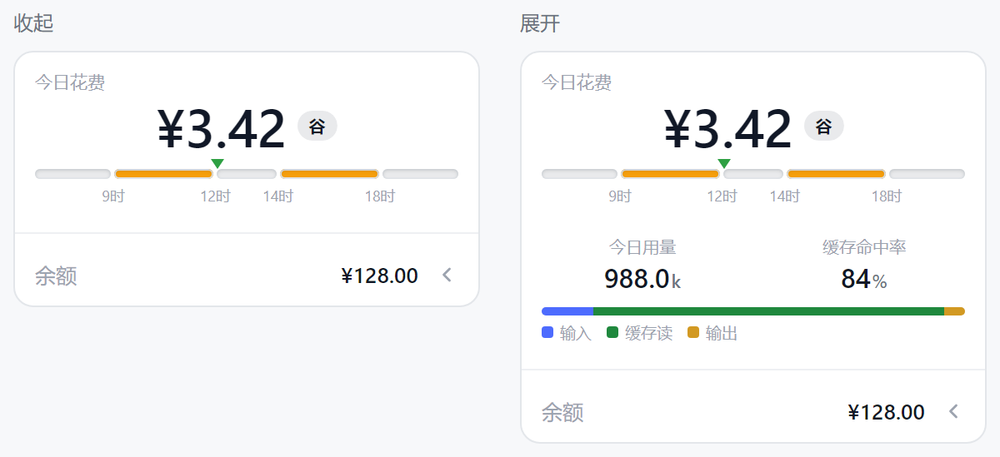
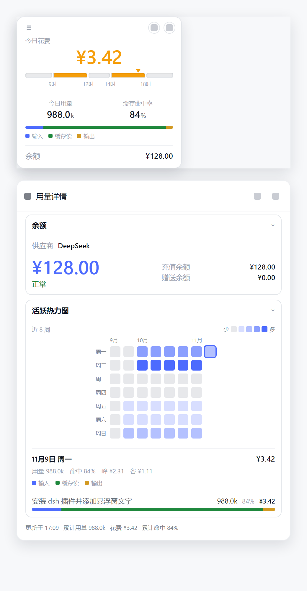

# dsh-usage-dock

DeepSeek Harness（`dsh web` / Windows 桌面版）的用量与余额悬浮卡：今天花了多少、花在哪个时段、每个会话花了多少，一眼看到。

> 本仓库 fork 自 [Aisland-SJL/dsh-usage](https://github.com/Aisland-SJL/dsh-usage)（MIT），在其基础上大幅重写：界面、数据口径与功能都做过调整，与原版不完全一致。

## 预览

## 功能

**悬浮卡（左下角）**
- 今日花费，右侧是「峰 / 谷」胶囊标签，与当前计价时段对应；悬停看精确金额与峰谷拆分
- 北京时间峰谷计价带（9-12、14-18 高峰，其余空闲半价），刻度标在段落交界
- 今日用量、缓存命中率，命中率旁有相对上次刷新的 ▲/▼/■ 指示
- 输入 / 缓存读 / 输出 三色成分条
- 余额，点击开合详情面板
- 收起 / 展开只改变显示的内容，字号不变

**详情面板（从悬浮卡右侧展开）**
- 余额：供应商、可用余额、充值/赠送明细
- 活跃热力图：近 8 周 × 7 天，点选任意一天，下方展开当日明细
  - 当日用量、命中率、峰/谷费用
  - 按会话分行：会话名、用量、命中率、花费、成分条；超过 5 个会话折叠
  - 悬停整行，看这一笔的精确用量、输入/输出拆分与峰谷费用
- 面板底部：累计用量、累计花费、累计命中率

## 空态口径

没有数据时不假装成 0：

| 显示 | 含义 |
| :--- | :--- |
| `0` / `¥0.00` | 测到的零，今天确实没有请求 |
| `—` | 没有这个数：今天没有请求时命中率无从计算，或供应商没有定价表 |
| `…` | 正在读取 |

## 键盘

- 余额行：`Tab` 聚焦，`Enter` / 空格 开合面板
- 热力图：`Tab` 进入网格后，方向键切换选中日期
- 面板：`Esc` 或点击面板外关闭

## 安装

要求 DSH `>= 0.2.1-rc.2`。

**从 Market**：在 DSH 的 Market 里搜索 `dsh-usage-dock` 安装。

**手动**：下载 Release 里的 `dsh-usage-dock.tgz`，在 DSH 插件页选择本地安装。

## 数据与隐私

- 用量来自**本机**会话日志（`~/.dsh/sessions`）与会话投影缓存（只为读会话标题），只读，不上传。
- 唯一的对外请求是**查询余额**：地址取 DSH 里配置的供应商 `baseURL`，凭证取 DSH 已保存的 API Key；不写日志、不落盘。
- **账户登录模式**（DSH 里用 DeepSeek 账户登录而不是填 API Key）不经过插件：余额由 Host 的账号服务（`deepseekAccount`）读取 Platform 钱包，插件只拿到归一化后的金额，既看不到授权 token，也没有任何 API Key 可读。
- 所以安装时的「会用你的密钥」提示只对应 API Key 这条路径：插件确实会读取你的 Key 去查一次余额，但只发往你在 DSH 里配置的那个上游地址，不落盘、不打印、不进前端响应。
- 无遥测、无更新检查、无任何第三方请求。

## 与原版的差异

- 移除双通道（Claude Code）统计、更新检查、写死的供应商列表
- 热力图由「28 天 × 4 小时」改为「8 周 × 7 天」，并支持按天、按会话下钻
- 峰谷计价改为 DeepSeek 官方人民币价目（峰时价，空闲 ×0.5）
- 面板与悬浮卡全部重做，跟随 DSH 主题 token

## 许可

MIT，见 `LICENSE`。上游版权声明保留在 `lib/balance.js`、`lib/safe-fetch.js` 的文件头注释中。
